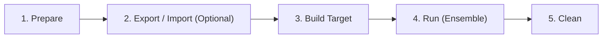

# Campaign Lifecycle & Execution Phases

## Overview

A Cyber Reasoning System (CRS) campaign in OSS-CRS progresses through a deterministic, phased lifecycle. This design decouples target-independent image builds from target compilation and live autonomous orchestration.



---

## 1. Phase 1: Prepare (`oss-crs prepare`)

The **Prepare** phase builds all static, target-independent components:

1. **CRS Source Resolution**:
   - Clones or updates CRS git repositories specified in `crs-compose.yaml`.
   - Checks out the requested commit, branch, or tag.
2. **Bake Execution**:
   - Parses the CRS's `bake.hcl` file specified in `crs.yaml`.
   - Executes `docker buildx bake` to build base container images for the CRS modules.
3. **Dependency Closures**:
   - For offline builds, builds the `oss-crs-deps` image providing self-contained Nix closures of `libCRS` and `rsync`.
4. **Validation**:
   - Validates that all declared modules, build steps, and required LLM providers exist.

```bash
uv run oss-crs prepare --compose-file ./example/crs-libfuzzer/compose.yaml
```

---

## 2. Phase 2: Export & Import (Air-Gapped Transfers)

For deployment in air-gapped, isolated, or remote testbeds:

- **Export (`oss-crs export`)**:
  - Packages prepared Docker images and required source metadata into a portable archive (`.tar.gz`).
  - Command: `uv run oss-crs export --compose-file compose.yaml --out bundle.tar.gz`
- **Import (`oss-crs import`)**:
  - Restores the exported images and registers the CRS on the remote host without requiring internet connectivity.
  - Command: `uv run oss-crs import --in bundle.tar.gz`

---

## 3. Phase 3: Build Target (`oss-crs build-target`)

The **Build Target** phase compiles the target software under test (OSS-Fuzz format) and runs each CRS's custom target preprocessing pipeline:

1. **Target Compilation**:
   - Compiles the target project with the specified sanitizer (`address`, `memory`, `undefined`, etc.) and engine (`libfuzzer`).
   - Caches compiled binaries in `.oss-crs-workdir/<sanitizer>/builds/<build-id>/`.
2. **CRS Target Build Pipeline**:
   - Executes the build steps defined in each CRS's `crs.yaml`.
   - Generates specialized harnesses, call graphs, dictionary files, or initial corpus seeds.
3. **Incremental Snapshots (`--incremental-build`)**:
   - Creates a Docker snapshot image containing the compiled build tree.
   - When enabled, subsequent rebuilds or patch verification runs spin up an ephemeral container from the snapshot rather than rebuilding from scratch.
4. **Coverage Instrumentation (`--coverage`)**:
   - Compiles a secondary Clang source-based coverage binary to feed real-time line/branch coverage to the WebUI dashboard.

```bash
uv run oss-crs build-target \
  --compose-file compose.yaml \
  --fuzz-proj-path ./oss-fuzz/projects/libxml2 \
  --sanitizer address
```

---

## 4. Phase 4: Run (`oss-crs run`)

The **Run** phase coordinates the live multi-container autonomous campaign via Docker Compose:

1. **Pre-flight Checks**:
   - Checks Docker daemon connectivity and cgroup v2 availability.
   - Validates that required environment variables and LLM API keys are present.
2. **Infrastructure Initialization**:
   - Starts `oss-crs-infra` services: LiteLLM proxy, PostgreSQL database, key-gen sidecar, and WebUI publisher.
   - Generates per-CRS LLM API keys with hard dollar budgets.
3. **Artifact Forwarding (`--forward-artifacts`)**:
   - Seeds the new run with findings, seeds, and reports from prior runs to accelerate coverage.
4. **Container Launch**:
   - Spawns all CRS modules, builder sidecars, and exchange services on isolated private networks with CPU and memory limits.
5. **Execution & Exchange**:
   - CRSs generate seeds, bug candidates, proof-of-vulnerabilities (POVs), and candidate patches.
   - The exchange sidecar synchronizes submissions across CRSs.
6. **Teardown & Log Persistence**:
   - Shuts down containers cleanly, copies run logs to `.oss-crs-workdir/<sanitizer>/runs/<run-id>/logs/`, and computes final token spend metrics.

```bash
uv run oss-crs run \
  --compose-file compose.yaml \
  --fuzz-proj-path ./oss-fuzz/projects/libxml2 \
  --target-harness xml \
  --web-ui
```

---

## 5. Phase 5: Clean (`oss-crs clean`)

The **Clean** phase removes lingering Docker images, containers, and workdir data:

- Subcommands:
  - `clean prepare`: Cleans prepare-phase images.
  - `clean build-target`: Cleans builder, snapshot, and target images.
  - `clean run`: Cleans run-phase compose images.
  - `clean --artifacts`: Deletes compiled build outputs, run logs, and submitted findings from the local filesystem.
